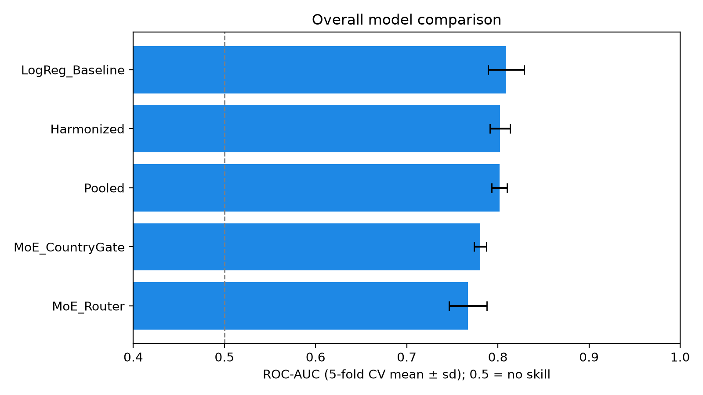

# 🌍 Digital Finance Access Predictor

## Overview

This project asks whether digital financial inclusion can be predicted from
socioeconomic and demographic survey data in East Africa (Kenya, Tanzania and
Uganda), and whether country-specific models in a **Mixture of Experts (MoE)**
architecture outperform a single **pooled** model.

A Streamlit app estimates the probability that a person has a digital financial
account, compares the models, and explains each estimate with per-profile
feature contributions (TreeSHAP values computed by XGBoost).

## Research Questions

1. Can digital financial inclusion be predicted from survey data?
2. Does a country-specific Mixture of Experts outperform a pooled model?
3. Does harmonising (balancing) country data improve performance?
4. Which individual factors contribute most to digital financial inclusion?

## Data

Global Findex 2021 individual responses: 1,000 per country (2,997 after
removing 3 rows with missing education). Target: `dig_account` (1 = has a
digital financial account; 76% of respondents). Codes follow the Findex
codebook; see [data/README.md](data/README.md).

Features: gender, age, education, income quintile, residence, internet use and
country. Country-level regulation indicators are **not** used as features: with
three countries they take only three values, so they repeat the country
indicator and cannot measure the effect of regulation.

## Models

| Model | Description |
|---|---|
| Pooled | One XGBoost model trained on all countries |
| Harmonized | XGBoost trained on an equal number of rows per country |
| Country experts | One XGBoost model per country (KEN, TZA, UGA) |
| MoE: own-country expert | Each person is scored by their own country's expert |
| MoE: learned router | An XGBoost classifier picks a model per person, trained on out-of-fold predictions |
| Logistic regression | A simple baseline |

## Results

5-fold cross-validated ROC-AUC (mean ± standard deviation; 0.5 = no skill):

| Model | ROC-AUC | Brier score (lower is better) |
|---|---|---|
| Logistic regression baseline | 0.809 ± 0.020 | 0.142 |
| Pooled | 0.802 ± 0.008 | 0.145 |
| Harmonized | 0.802 ± 0.011 | 0.145 |
| MoE: own-country expert | 0.781 ± 0.007 | 0.156 |
| MoE: learned router | 0.767 ± 0.021 | 0.174 |



**Findings**

1. **Yes, inclusion is predictable, moderately.** ROC-AUC is about 0.80.
   Accuracy alone is misleading here: about 76% of respondents have an account, so
   always predicting "yes" already scores 76%.
2. **No, the Mixture of Experts did not beat the pooled model.** Each country
   expert learns from only about 800 people; pooling gives more data to learn
   shared patterns. This holds on like-for-like, per-country comparisons
   ([results/per_country_comparison.csv](results/per_country_comparison.csv)).
3. **Harmonising made no measurable difference.**
4. **A simple logistic regression performs as well as XGBoost** on these
   features, which suggests the relationships are mostly simple and additive.
5. **Fairness:** performance is somewhat lower for women (AUC 0.76 vs 0.78 for
   men) and for urban respondents (0.73 vs 0.76 rural), whose small test group
   (128) makes the estimate uncertain
   ([results/fairness_results.csv](results/fairness_results.csv)).

## Repository Structure

```text
app.py                   Streamlit app
train.py                 Reproducible training and evaluation pipeline
models/                  Trained models (XGBoost JSON) and model_info.json
results/                 Evaluation tables and charts
data/README.md           Data description and codes
notebooks/               v1 thesis notebook (kept for the record)
requirements.txt         App dependencies
requirements-train.txt   Extra dependencies for training
```

## Running

Run the app:

```bash
pip install -r requirements.txt
streamlit run app.py
```

Retrain the models and regenerate `results/` (needs `data/final_combined_data.csv`):

```bash
pip install -r requirements-train.txt
python train.py
```

## Changes from the v1 Thesis Notebook

The v1 notebook is kept in `notebooks/`. Version 2 corrects the following:

- Residence codes were reversed (Findex: 1 = Rural, 2 = Urban), and the app offered
  education codes that do not exist in the data.
- The app subtracted a fixed penalty from the model's probability. It now shows
  the model's own estimate.
- The survey weight `wgt` was used as a feature. It no longer is.
- The router was trained on in-sample predictions. It now uses out-of-fold
  predictions.
- Models are compared on the same rows, ranked by ROC-AUC, with cross-validation.

## Limitations

- About 1,000 respondents per country from a single survey year.
- Survey weights are not applied, so results describe the sample, not national populations.
- Estimates describe patterns in survey data, not individuals, and should support,
  not replace, human judgement.

## Author

Winnie MejaSitah Lang'o, MSc research project, 2026:
*Digital Financial Inclusion Prediction using a Mixture of Experts Architecture for East Africa*
